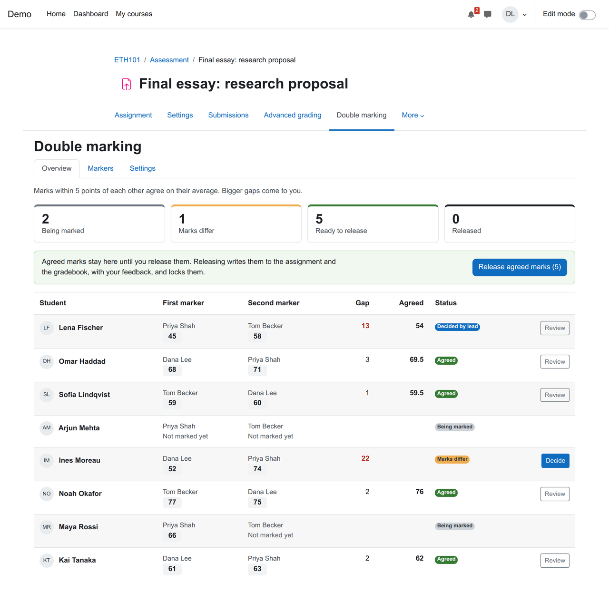
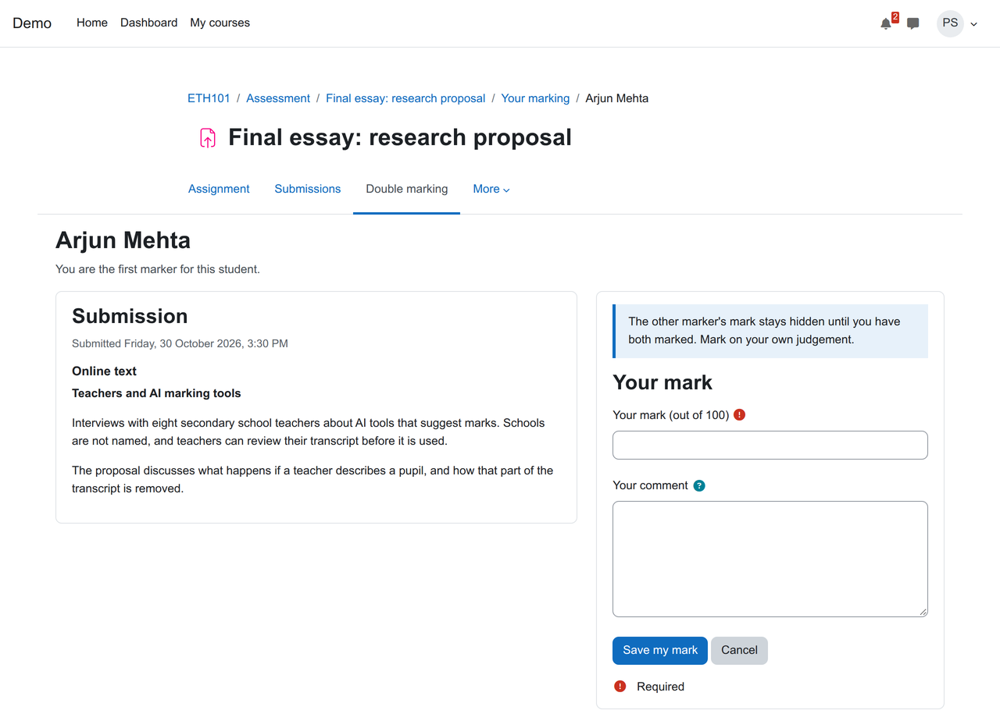

# Double marking for Moodle Assignment (local_doublemark)

[](https://github.com/devlms/moodle-local_doublemark/actions/workflows/ci.yml)
[](https://devlms.github.io/moodle-local_doublemark/)
[](https://devlms.github.io/moodle-local_doublemark/php-coverage/)
[](https://moodledev.io/general/releases)
[](https://www.php.net/supported-versions.php)
[](LICENSE)
[](version.php)

Two markers mark each submission on their own. Neither sees the other's mark until both are in. Close marks agree by a rule you choose, marks that differ go to the module lead, and nothing reaches the student until the lead releases it. It works on the normal Assignment activity, so you keep your submissions, deadlines and extensions.

Universities that double mark coursework mostly do it in a spreadsheet next to Moodle. Moodle 5.3 added its own multiple marking to Assignment, but earlier versions have none, and the plugins that do it either replace Assignment with a different activity or let the first grader see everything. This plugin keeps the two marks apart and the agreement on record, on every Moodle from 4.5 to 5.3. An assignment that already uses Moodle 5.3's multiple marking cannot also use this plugin.



## What it does

| Part | Status |
| --- | --- |
| Turn double marking on per assignment, from the assignment's own menu | Done |
| First and second marker per student. Share students out evenly with one click, or set them by hand | Done |
| Markers see the submission and enter a mark and a private comment. The other mark stays hidden until both are in | Done |
| Tolerance in points. Close marks agree on the average, the higher mark or the first marker's, or the lead decides every time | Done |
| Marks that differ by more than the tolerance go to the lead, who sees both marks, both comments and the submission side by side | Done |
| The lead's agreed mark, feedback for the student and a note for staff | Done |
| Release: agreed marks go to the assignment and the gradebook through Moodle's own grading code, with marking workflow set to Released when it is on. Released marks are locked | Done |
| A warning when someone typed a grade in the assignment directly, outside double marking | Done |
| Anonymous submissions: students show as Participant numbers while the assignment hides identities | Done |
| Log events for every mark, agreement and release. Privacy API export and delete | Done |
| Rubrics and marking guides, scales, group submissions | Planned |
| Course backup and restore of marks and allocations | Planned |



## How it keeps the marks apart

Markers never open the assignment's grading screen for a double marked student: the submission is shown inside this plugin's page, from the assignment's own submission plugins, so there is no grade box to type into. Marks stay in this plugin's tables until the lead releases them. If a grade does appear in the assignment before that, the overview flags it. Annotating PDFs in the browser is not available on the marking page; download the file instead.

## Install

Needs Moodle 4.5 to 5.3.

1. Download the zip from [Releases](https://github.com/devlms/moodle-local_doublemark/releases) and install it under Site administration, Plugins, Install plugins. Or clone it:

   ```bash
   # Moodle 4.5 and 5.0
   git clone https://github.com/devlms/moodle-local_doublemark.git local/doublemark
   # Moodle 5.1 and later
   git clone https://github.com/devlms/moodle-local_doublemark.git public/local/doublemark
   ```

2. Visit Site administration, Notifications to finish the install.
3. In an assignment graded out of points, open "Double marking" in the assignment's menu, turn it on and share students out.

## Permissions

| Capability | Default roles | Allows |
| --- | --- | --- |
| `local/doublemark:manage` | Teacher, manager | Turn double marking on, allocate markers, agree and release marks |
| `local/doublemark:mark` | Teacher, non-editing teacher | Be one of a student's two markers |

## Privacy

A student's data request covers both marks about them, the markers' comments and the agreed mark with feedback. A marker's request covers the marks they gave. Deleting a marker's data keeps the marks without their name, because removing a mark would change a student's agreed grade.

## Tests

PHPUnit covers the agreement rules, allocation, the hidden second mark, the lead's decision, release to the gradebook with and without marking workflow, the pages' data and the privacy provider. Behat walks two markers and a lead through a submission, with Moodle's accessibility checks on every page. CI runs on Moodle 4.5 to 5.3 with PostgreSQL and MariaDB: [reports](https://devlms.github.io/moodle-local_doublemark/).

## Who made it

[DevLMS](https://devlms.com) builds custom Moodle plugins. Need something like this changed for your institution, or a different plugin? [Get a quote](https://devlms.com/#quote).

## License

GNU GPL v3 or later.
